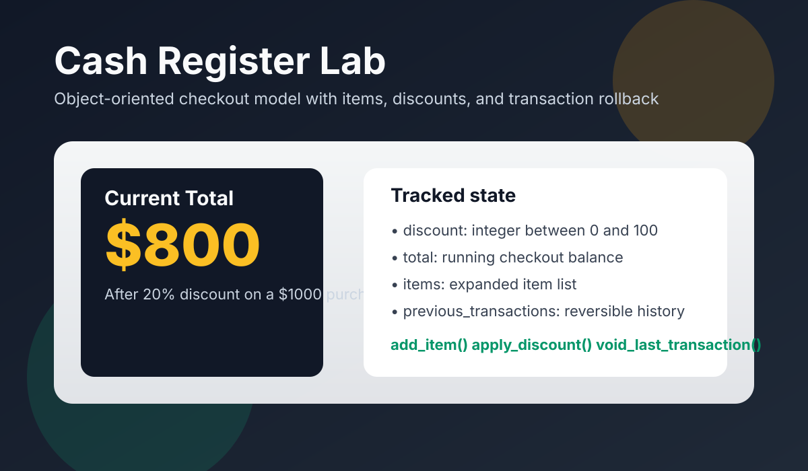

# Cash Register Lab

This project models a simple cash register for an e-commerce checkout flow. The register tracks a running total, the items added to the cart, prior transactions, and an optional percentage discount.

## Features

- Add items with a price and optional quantity.
- Track every item added in the register state.
- Apply a percentage discount to the current total.
- Void the most recent transaction and roll back the total and item list.

## Preview

## Usage

Import `CashRegister` from `lib/cash_register.py`, create an instance, and call `add_item`, `apply_discount`, or `void_last_transaction` as needed.

## Notes

- Discount values must be integers from 0 to 100.
- Invalid discounts print `Not valid discount`.
- Calling `apply_discount` with no prior transactions prints `There is no discount to apply.`
- Calling `void_last_transaction` with no prior transactions prints `There is no transaction to void.`
